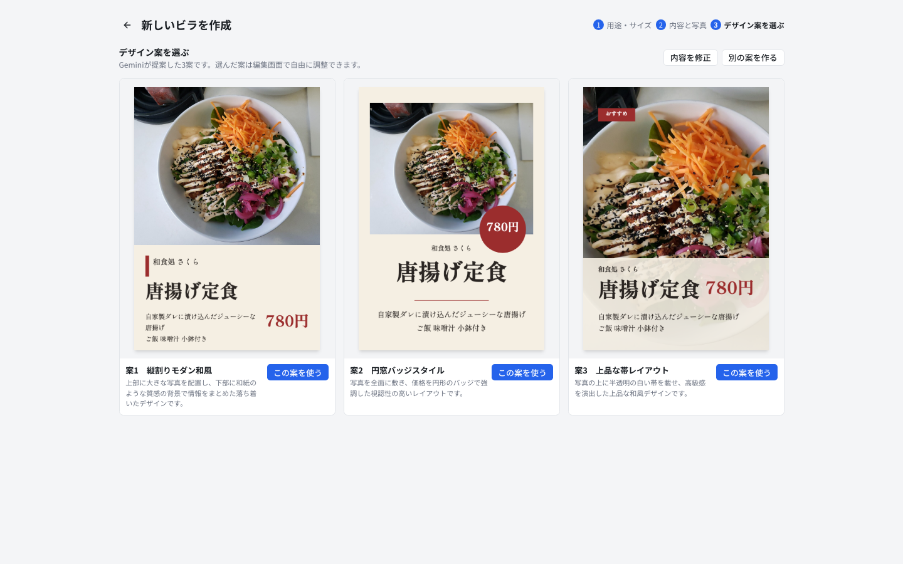
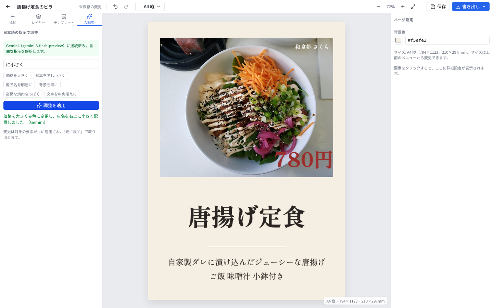
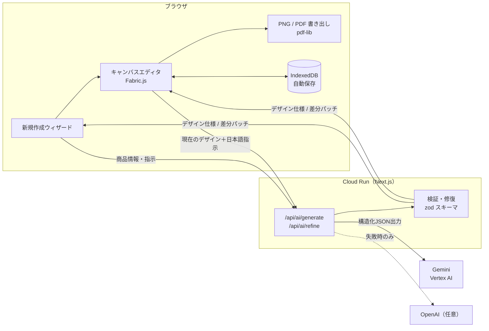

# ビラ・POPメーカー

**料理写真と日本語のひとことから、飲食店のビラ・POPを数十秒で。しかも全部あとから編集できる。**

商品名と価格を入れて、料理写真を載せ、「落ち着いた和食店の雰囲気で」と書くだけ。Gemini がレイアウトを3案提案します。選んだ案はキャンバス上で文字も写真も自由に動かせます。「値段をもっと大きく赤色に」と日本語で頼むこともできます。完成したら、印刷用PDF（実寸・300dpi）か、SNS用PNGで書き出せます。

**デモ：https://prmaker-133131792767.asia-northeast1.run.app**（Cloud Run、ログイン不要）

試し方：「新しいビラを作成」を押し、A4縦を選んで、商品名・価格・料理写真を入れて「デザイン案を3つ作成」を押します。作ったビラはブラウザ内に保存され、サーバーには残りません。

| 3案の提案 | 日本語での調整 |
| --- | --- |
|  |  |

## 解決したい課題

個人経営の飲食店は、季節メニューや日替わりのビラ・POPを頻繁に作り直します。けれど多くの店にはデザイナーがいません。

- 汎用デザインツールはテンプレートが多すぎて、選んで直すだけで時間がかかる
- 画像生成AIで作ると、文字が崩れたり、存在しない価格やメニューが紛れ込んだりする
- 生成された画像は1枚絵なので、値段を1つ直すだけでも作り直しになる

## このアプリのアプローチ

**AIには「絵」ではなく「レイアウトの設計図」を作らせます。** Gemini が返すのは、文字・写真・図形の位置、書体、色を記述した JSON です。アプリがそれを編集可能なキャンバスに組み立てます。

- **文字は常に正確です。** 店名・商品名・価格・説明文は入力された文字列だけを使います。価格はサーバー側で入力値に上書きするので、AIが値段を書き換えることはありません。
- **すべて編集できます。** 生成後も、要素ごとに位置・サイズ・書体・色を変えられます。元に戻す・やり直しにも対応しています。
- **日本語の指示で部分修正できます。** 「店名は右上に小さく」と頼むと、AIは変更が必要な要素だけを差分として返します。他の要素はそのまま残ります。
- **AIが無くても動きます。** キー未設定時や、AIが混雑・上限に達したときは、内蔵のルールベース生成と定型指示による調整で続行します。何が起きたかは画面に明示します。

## 主な機能

- 新規作成ウィザード：用途・サイズ → 内容と写真 → 3案から選択
- サイズ：A4 / A5（縦・横）、Instagram 正方形・縦型、カスタムサイズ
- キャンバス編集（Fabric.js）：ドラッグ移動、リサイズ、整列ガイド、テキスト直接編集、レイヤー、図形・画像追加、元に戻す／やり直し
- 日本語フォント5書体を同梱（ゴシック・丸ゴシック・明朝）
- AI調整：自由な日本語の指示で、変更点だけを適用
- 書き出し：PNG（印刷サイズは300dpi）、印刷用PDF（実寸mm）、再編集用プロジェクトファイル
- 保存：ブラウザ内（IndexedDB）に自動保存。サーバーに個人データを置きません

## 使っている Google の技術

| 技術 | 用途 |
| --- | --- |
| **Gemini**（`@google/genai`、既定モデル `gemini-3-flash-preview`） | レイアウト3案の生成と、日本語指示による差分修正。JSONモードで出力させ、サーバー側でスキーマ検証と修復 |
| **Vertex AI** | Cloud Run 上では Gemini を Vertex AI 経由で呼び出し、サービスアカウントで認証。APIキーを保存しません |
| **Cloud Run** | アプリ本体のホスティング（Next.js standalone の Docker イメージ） |
| **Cloud Build / Artifact Registry** | `gcloud run deploy --source .` によるソースからのビルドとイメージ保管 |

OpenAI API にも対応しています。キーを設定した場合に限り、Gemini が失敗したときの予備として自動で使われます。

## アーキテクチャ



### AI出力を信頼できるものにする工夫

モデルの出力をそのまま描画せず、サーバー側で検証と修復をしてからブラウザへ返します。

- **事実の固定**：プロンプトで、入力にない価格・営業時間・住所などの追加を禁止しています。さらに価格の文字列はサーバーで入力値に置き換えます。
- **スキーマ検証**：全要素を zod で検証します。壊れた装飾要素は捨て、文字や写真が壊れている場合は案ごと不採用にします。
- **座標の修復**：モデルが文字の x 座標を「中央揃えの中心点」や「右揃えの右端」として返すことがあります。その場合、紙面からはみ出す文字ボックスを検出し、意図した位置に置き直します。
- **1行に収める**：価格・商品名・店名などの短い文字が枠に収まらないときは、揃えの基準を保ったまま枠を広げ、紙面に入りきらないときだけ文字を小さくします。AIが追加した装飾は文字の背面に置きます。
- **色・線幅の正規化**：`transparent` やピクセル単位の線幅など、仕様外の値を変換します。
- **句読点の除去**：チラシの文言から「、」「。」を外し、改行と空白で区切ります。
- **応答速度**：レイアウトのJSONに深い推論は要らないので、Gemini 3 の思考レベルを LOW にしています。Vertex AI ではスキーマ制約付きの生成が非常に遅かったため、スキーマはプロンプトで示し、検証はサーバーで行います。3案の生成は約12〜20秒です。
- **障害時の扱い**：1回の呼び出しは45秒で打ち切ります。上限超過や混雑は短い日本語メッセージで知らせ、予備のプロバイダか内蔵生成で続行します。

## ローカルで動かす

Node.js 24 以上が必要です。

```bash
npm install
cp .env.example .env.local   # AIを使う場合はキーを設定（任意）
npm run dev                  # http://localhost:3000
```

`.env.local` の主な設定です。すべて任意で、キーはサーバー側でのみ使われます。

```
GEMINI_API_KEY=...            # Google AI Studio のキー
# または Vertex AI（gcloud auth application-default login 済みの環境）
GOOGLE_GENAI_USE_VERTEXAI=true
GOOGLE_CLOUD_PROJECT=your-project
GOOGLE_CLOUD_LOCATION=global
OPENAI_API_KEY=...            # 予備（任意）
```

## Cloud Run へのデプロイ

課金が有効な Google Cloud プロジェクトで、次を実行します。

```bash
PROJECT_ID=your-project ./scripts/deploy-cloudrun.sh
```

このスクリプトは次の処理を行います。

1. Cloud Run、Cloud Build、Artifact Registry、Vertex AI の API を有効化
2. 実行サービスアカウントに Vertex AI ユーザー権限を付与
3. ソースからビルドして `asia-northeast1` にデプロイし、公開URLを表示

Gemini は Vertex AI 経由で呼ばれるため、APIキーをデプロイする必要はありません。OpenAI を予備に使う場合は、Secret Manager に保存したシークレット名を `OPENAI_SECRET` に指定します。

## テスト

```bash
npx playwright install chromium
npm run typecheck && npm run lint
npm run test:e2e
```

費用を抑えるため、テスト時は安価なモデルでサーバーを起動しています。

```bash
npm run build
GEMINI_MODEL=gemini-3.1-flash-lite OPENAI_MODEL=gpt-5.4-mini npm run start   # 別ターミナルで npm run test:e2e
```

E2E テストは Playwright で、作成から編集、保存・復元、PNG/PDF 書き出し、サイズ変更、元に戻す、AI調整までを通しで確認します。書き出したファイルとスクリーンショットは `tests/output/` に保存されます。

## ディレクトリ構成

| パス | 内容 |
| --- | --- |
| `src/lib/design/` | デザイン仕様（zod スキーマ）、スタイル辞書、ルールベース生成、ローカル調整、Fabric との相互変換 |
| `src/lib/ai/` | AIプロバイダ（`provider.ts` が選択と予備への切り替え、`gemini.ts` / `openai.ts`）、共通プロンプトと出力修復（`shared.ts`） |
| `src/app/api/ai/` | `status` / `generate` / `refine` のルートハンドラ |
| `src/components/editor/` | エディタ（コントローラ、ツールバー、左右パネル、キャンバス） |
| `src/components/wizard/` | 新規作成ウィザードと3案プレビュー |
| `src/lib/db.ts` / `src/lib/export.ts` | IndexedDB 保存、PNG/PDF 書き出し |
| `Dockerfile` / `scripts/deploy-cloudrun.sh` | Cloud Run 用イメージとデプロイ |
| `tests/` | Playwright E2E |

## クレジット

- スクリーンショットの料理写真：Wikimedia Commons「Classic Chicken Karaage - Sunoso 2023-11-28」（CC0）。リポジトリには含めていません。
- 日本語フォント：Noto Sans JP / Noto Serif JP / Zen Kaku Gothic New / M PLUS Rounded 1c / しっぽり明朝（いずれも SIL Open Font License、`@fontsource` 経由）

## 今後やりたいこと

- 店舗ごとのブランド設定（ロゴ、色、書体）を保存し、毎回の提案に反映する
- 複数メニューを並べるメニュー表・お品書きレイアウト
- 写真の自動切り抜きと明るさ補正
